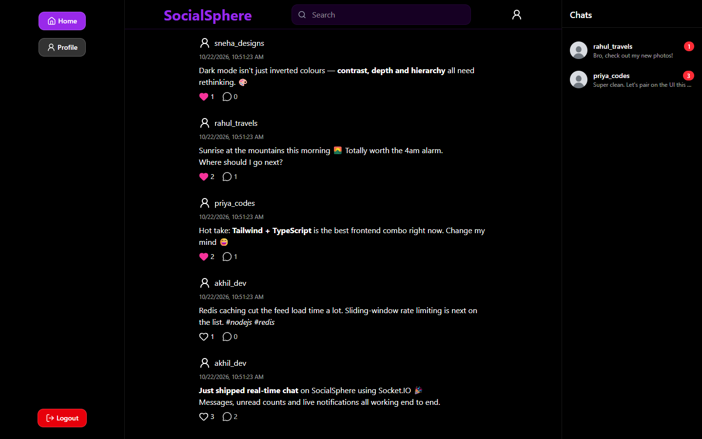
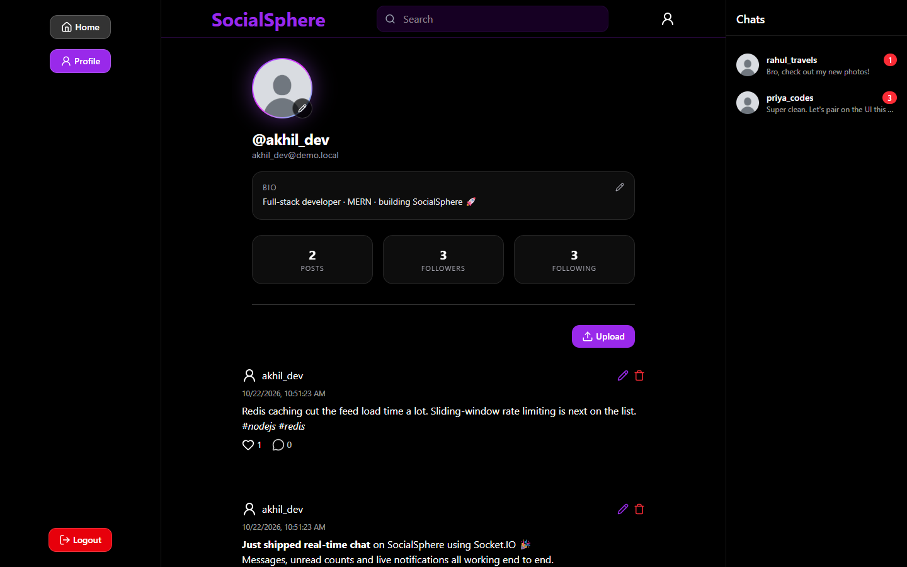
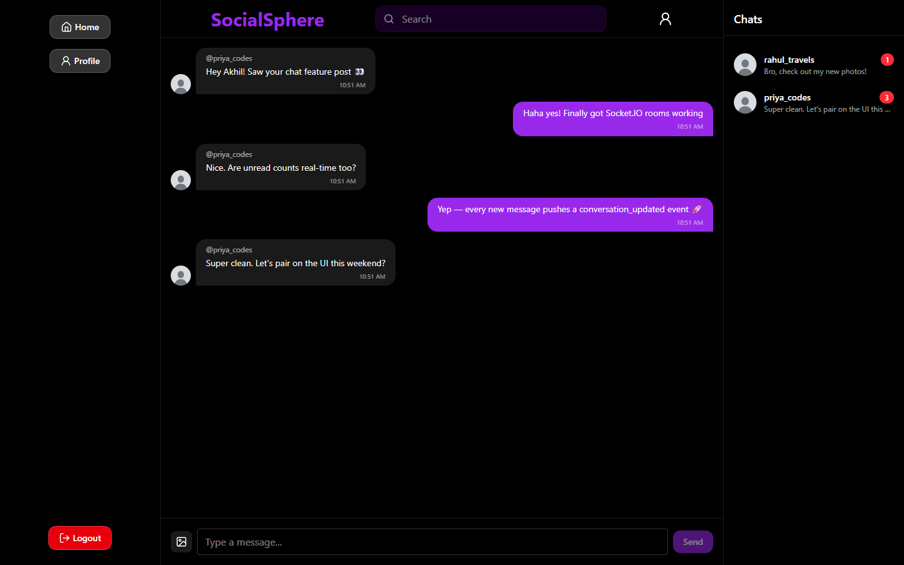
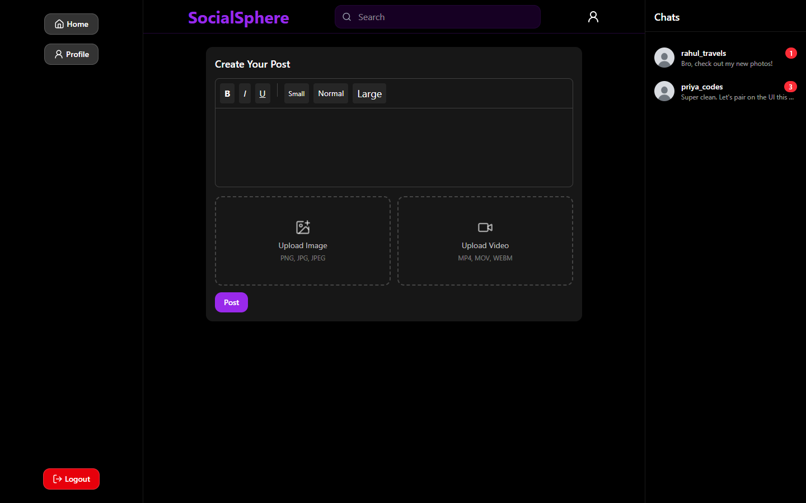
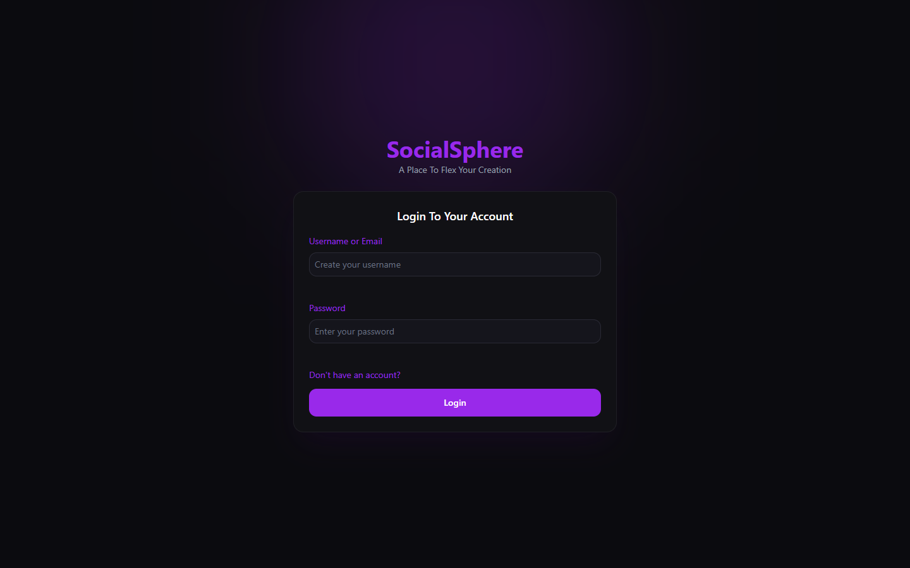
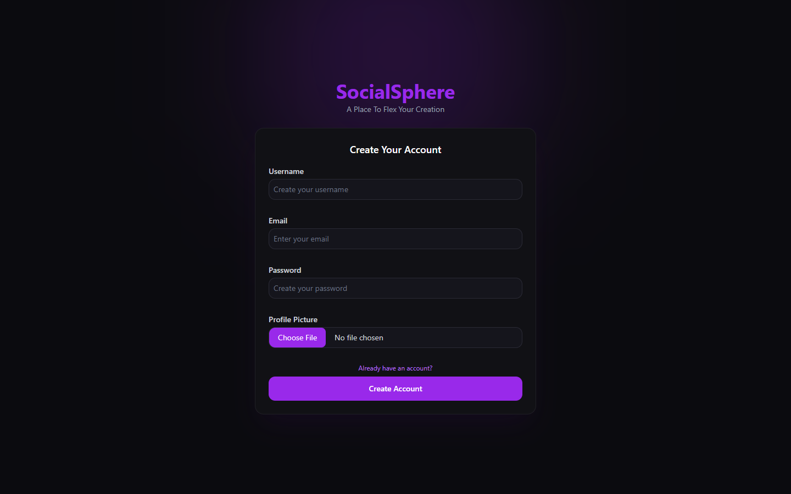
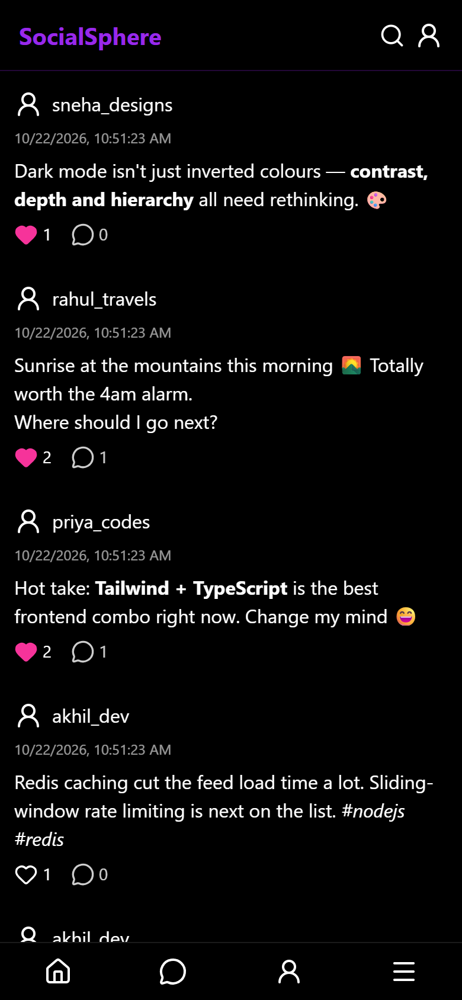
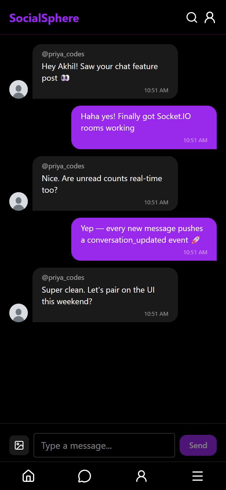

# SocialSphere — MERN Social Media App

A full-stack social media app built with MongoDB, Express, React and Node (TypeScript throughout).



## Screenshots

| Profile | Real-time chat |
| ------- | -------------- |
|  |  |

| Create post (rich text + image/video) | Login |
| ------------------------------------- | ----- |
|  |  |

| Register | Mobile feed | Mobile chat |
| -------- | ----------- | ----------- |
|  |  |  |

## Features

- Register / login with JWT access + refresh tokens (httpOnly cookies)
- Rich-text posts (TipTap) with image or video upload (Cloudinary, HLS playback)
- Likes, comments, follow / unfollow, user profiles
- Search for users and posts
- Real-time 1:1 chat with unread counts, and live like/comment notifications (Socket.IO)
- Redis caching and Redis-backed sliding-window rate limiting
- Docker Compose + nginx setup for deployment

## Tech stack

| Layer    | Tech |
| -------- | ---- |
| Frontend | React 19, Vite, TypeScript, Redux Toolkit, React Router, Tailwind CSS, TipTap, hls.js, react-hook-form + zod |
| Backend  | Node.js, Express 5, TypeScript, Mongoose, Socket.IO, Redis, Multer, Cloudinary |
| Infra    | Docker, Docker Compose, nginx |

## Project structure

```
backend/    Express API + Socket.IO server (src/controllers, models, routes, middlewares)
frontend/   React app (src/pages, components, api, store)
nginx/      nginx config + Dockerfile that builds the frontend and proxies the API
docker-compose.yml      full stack (production-style)
docker-compose.dev.yml  only MongoDB + Redis, for local development
```

## Running locally

### Prerequisites

- Node.js 20+
- MongoDB (local install or Docker)
- Redis (optional — without it the app runs with caching and rate limiting disabled)
- A free [Cloudinary](https://cloudinary.com) account for image/video uploads

### 1. Start MongoDB and Redis

If you have Docker:

```bash
docker compose -f docker-compose.dev.yml up -d
```

Or use a locally installed MongoDB on `mongodb://localhost:27017`.

### 2. Backend

```bash
cd backend
cp .env.sample .env      # then fill in the token secrets and Cloudinary keys
npm install
npm run dev              # http://localhost:4000
```

Check it's up: http://localhost:4000/api/v1/test/test-api

### 3. Frontend

```bash
cd frontend
npm install
npm run dev              # http://localhost:5173
```

The Vite dev server proxies `/api` and `/socket.io` to the backend on port 4000, so no frontend `.env` is needed. See `frontend/.env.sample` if the backend is hosted on a different domain.

## Running with Docker (full stack)

```bash
cp backend/.env.sample backend/.env   # fill in secrets
docker compose up --build
```

Open http://localhost. nginx serves the built frontend and proxies the API and websockets to the backend; MongoDB and Redis run as containers.

## Environment variables (backend)

| Variable | Description |
| -------- | ----------- |
| `PORT` | API port (default 4000) |
| `CORS_ORIGIN` | Allowed frontend origin |
| `MONGO_URI`, `DB_NAME` | MongoDB connection |
| `REDIS_URL` | Redis connection |
| `ACCESS_TOKEN_SECRET`, `ACCESS_TOKEN_EXPIRY` | Access-token JWT settings |
| `REFRESH_TOKEN_SECRET`, `REFRESH_TOKEN_EXPIRY` | Refresh-token JWT settings |
| `CLOUDINARY_CLOUD_NAME`, `CLOUDINARY_API_KEY`, `CLOUDINARY_API_SECRET` | Media uploads |

## API overview

All routes are under `/api/v1`:

- `users` — register, login, logout, refresh-token, current-user, profile, follow/unfollow, search
- `posts` — create, feed, user posts, post by id, update, delete, search
- `comments` — create, list, delete
- `likes` — toggle like, list likers
- `chats` — get/create conversation, send message, messages, mark seen, conversations
